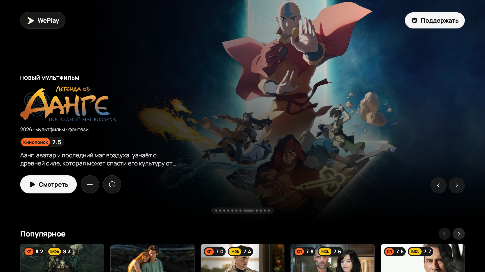
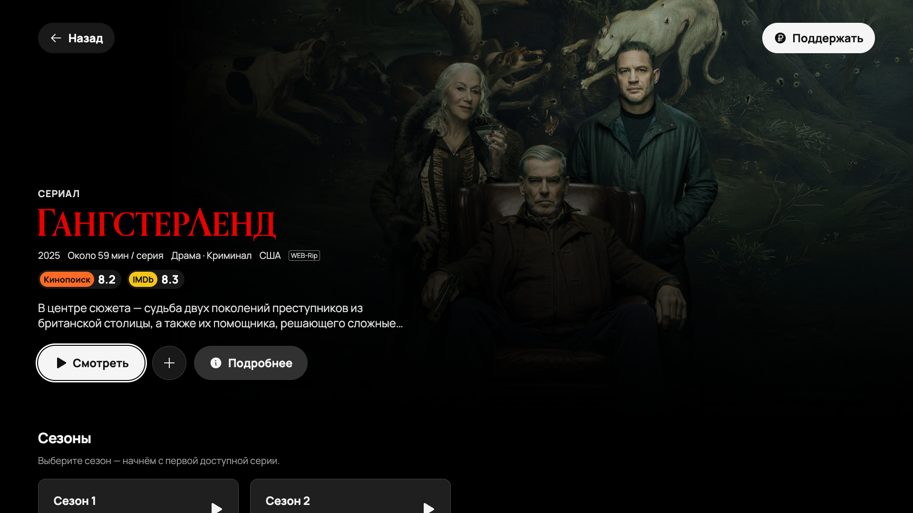

# WePlay

WePlay — приложение для просмотра фильмов, сериалов и мультфильмов на **Samsung Tizen, LG webOS, Android TV и Google TV**. Интерфейс рассчитан на пульт, а видео воспроизводится внутри приложения.

Для каталогов и просмотра нужен интернет. После установки WePlay работает без включённого компьютера.

## Скачать

| Платформа | Требования | Установщик | Инструкция |
| --- | --- | --- | --- |
| Samsung Tizen | Tizen 5.5 и новее | [Скачать WGT](https://github.com/bogdanhpk/WePlay/raw/refs/heads/main/downloads/WePlay-Tizen.wgt) | [Установка на Samsung](docs/INSTALL.md) |
| LG webOS | webOS TV 5.0 и новее, Developer Mode | [Скачать IPK — 1.0.3](https://github.com/bogdanhpk/WePlay/raw/refs/heads/main/downloads/app.weplay.tv_1.0.3_all.ipk) | [Установка на LG](docs/INSTALL_WEBOS.md) |
| Android TV / Google TV | Android 8.0 и новее, Android System WebView | [Скачать APK — 1.0.18](https://github.com/bogdanhpk/WePlay/raw/refs/heads/main/downloads/WePlay-AndroidTV-1.0.18.apk) | [Установка на Android TV](docs/INSTALL_ANDROID_TV.md) |

[Контрольные суммы SHA256](downloads/SHA256SUMS.txt)

Для Samsung Tizen скачайте WGT, для LG webOS — IPK, для Android TV и Google TV — APK.

## Возможности

- Каталог фильмов, сериалов и мультфильмов, новинки и тематические подборки.
- Объединение каталогов из нескольких источников с автоматическим подключением.
- Поиск по всем подключённым источникам с экранной клавиатурой ЙЦУКЕН и QWERTY.
- Встроенный плеер с выбором озвучки, серии, качества и субтитров, когда они доступны у источника.
- Страницы медиа с описанием, рейтингами, длительностью, актёрами и сезонами.
- Избранное, сохранение позиции просмотра и раздел «Продолжить просмотр». Удерживайте OK на карточке, чтобы открыть плавающее меню и убрать её со сбросом прогресса.
- Карточка продолжения: следующая серия с пятисекундным отсчётом, следующая часть фильма — по нажатию. [Как работает](docs/POSTPLAY.md).
- Управление пультом и подтверждение выхода из просмотра.

## Интерфейс

**Главная страница**

**Профиль сериала**

## Установка

### Samsung Tizen

Для первой установки нужен компьютер. Включите Developer Mode на телевизоре, подготовьте сертификаты и установите WGT по [инструкции для Samsung](docs/INSTALL.md). В ней также описаны добавление приложения на главный экран и повторная установка с сохранением данных.

После установки компьютер можно выключить.

### Android TV и Google TV

1. Передайте APK на телевизор или приставку через USB или приложение для передачи файлов.
2. Откройте APK в файловом менеджере. Если Android запросит разрешение на установку из этого приложения, разрешите её.
3. Нажмите «Установить», затем откройте WePlay в списке приложений телевизора.

Подробнее, включая установку через ADB: [инструкция для Android TV](docs/INSTALL_ANDROID_TV.md).

### LG webOS

Включите Developer Mode на телевизоре и установите IPK с компьютера через webOS CLI. [Инструкция для LG](docs/INSTALL_WEBOS.md).

## Обновления

### Samsung Tizen

Приложение загружает подписанные обновления интерфейса и сохраняет их на телевизоре. Когда обновление готово, рядом с «Поддержать» появляется кнопка **«Доступна новая версия»**. Завершите просмотр и нажмите её, чтобы применить обновление. Загруженная версия также запускается при следующем открытии WePlay.

История просмотра и избранное сохраняются. Если новая версия не запускается, загрузчик возвращается к предыдущей рабочей версии. При недоступном интернете запускается сохранённый или комплектный интерфейс; каталоги и видео требуют подключения к сети.

Изменение системной иконки, разрешений Tizen или самого загрузчика требует установки нового WGT.

### Android TV и Google TV

Начиная с **1.0.1**, WePlay проверяет новые APK в GitHub. Когда доступно обновление, рядом с «Поддержать» появляется кнопка **«Доступна новая версия»** с иконкой скачивания и цветным свечением.

Нажмите кнопку, затем **«Скачать и обновить»**. Приложение скачает и проверит APK, после чего откроет системное подтверждение Android. При первом обновлении разрешите WePlay устанавливать приложения и вернитесь назад. История и избранное сохраняются.

Если установлена версия **1.0.0**, один раз установите актуальный APK поверх неё вручную. Не удаляйте приложение перед обновлением.

У Android отдельный канал обновлений; версии Tizen на него не влияют. Для владельца репозитория: [как опубликовать новый APK](docs/ANDROID_UPDATES.md).

### LG webOS

Один раз установите IPK **1.0.3** поверх текущей версии. После этого WePlay загружает подписанные обновления интерфейса из GitHub. Когда обновление готово, рядом с «Поддержать» появится кнопка **«Доступна новая версия»**. [Инструкция для LG](docs/INSTALL_WEBOS.md).

## Совместимость и данные

Версия для Tizen проверена на Samsung Q60T 2020 года с Tizen 5.5. Android-версия проверена в эмуляторе Android TV 12; проверка на физическом Android TV пока не выполнена. Для webOS загрузка каталога, навигация и тестовое воспроизведение HLS и MP4 проверены в Chromium. Проверка на телевизоре LG ещё предстоит.

Доступность видео, озвучек, серий, качества и субтитров зависит от источника. Поддержка кодеков зависит от устройства; на Android TV — также от версии Android System WebView.

История просмотра и избранное хранятся на устройстве и не синхронизируются между телевизорами. Личные API-ключи владельца проекта в публичные установщики не включены.

Об источниках обложек и фотографий актёров: [ресурсы изображений](docs/MEDIA_RESOURCES.md).
